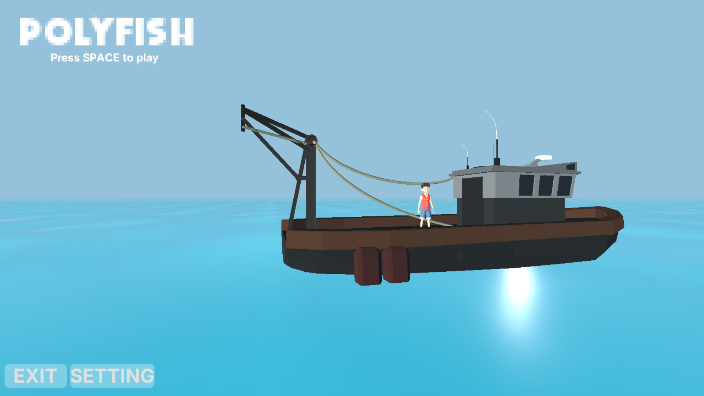
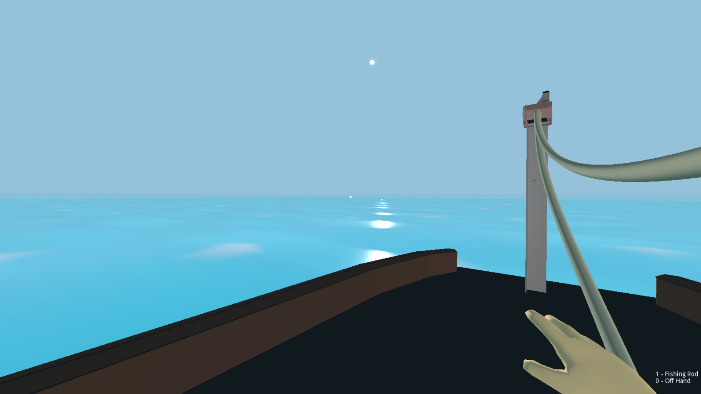
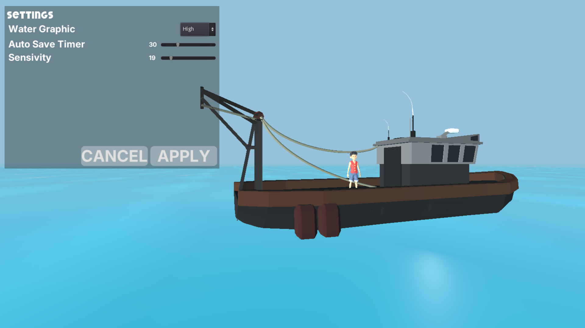

# PplyFish

I try to create 3d game in Godot 3.6.3 name with PolyFish. The main theme about this game is
fishing in sea on a boat.

## Features

| Name | Description |
| ---- | ----------- |
| Main Menu | Clear main menu with setting, exit, adn transition from main menu to the in game. |
| Setting | Simply setting, graphics, sensivity, water, etc |
| Fishing Rod | Fishing rod as item with 1 button to use |
| Hand | Hand UI |
| Keyboard and Touchscreen | Export on desktop with keyboard mapping and android or mobile with touchscreen button |
| Fishing System | Fish with rod using left mouse, and random time and fish with precentace |
| Physics | Walk and Jump with clear gravitation |

## How to install?

First, clone this repository, and then open your godot (must be 3.6.3+), and click "Import" in right menu. Nad chose project.godot in folder where you clone this repository. And clear, you can run
and play or export it into apk or exe.

## Reqruirments

- Godot 3.6.3+

## Previews

## Contribute

You can contribute for my game with clone and make a pull request.

## License

MIT License
